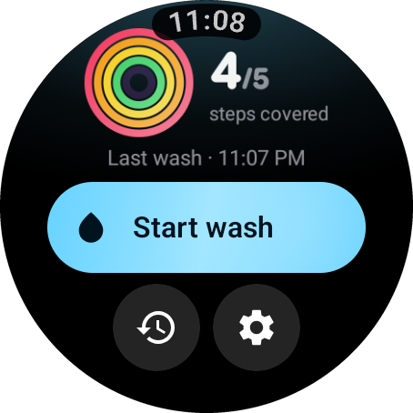
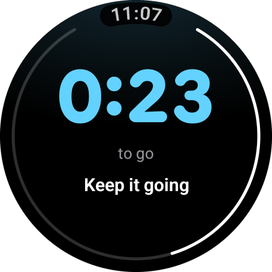
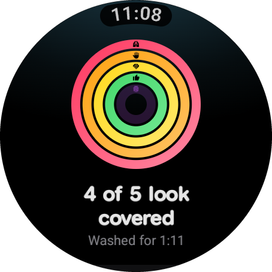
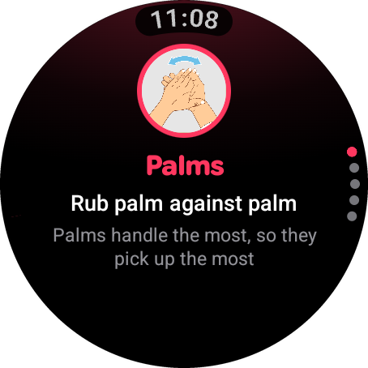
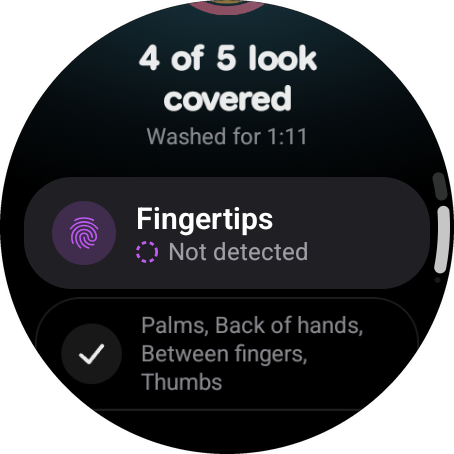
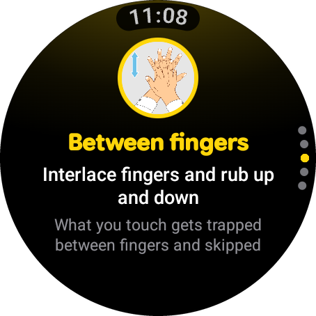
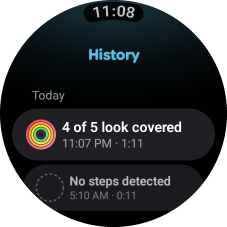
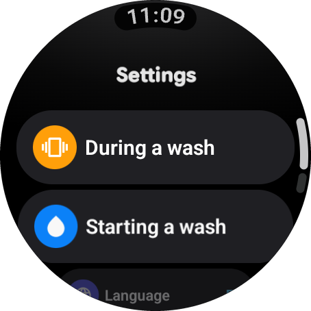

<p align="center">
  
</p>

<h1 align="center">HapticWash</h1>

<p align="center">
  <strong>A hand-washing coach for your wrist.</strong><br>
  A Wear OS app that watches how you move during a wash and tells you which of the five WHO hand-rubbing steps looked covered. It runs fully offline, on the watch.
</p>

<p align="center">
  
  
  
  
  
  
</p>

<p align="center">
  
  
  
  
</p>

---

## What it does

Tap **Start wash** and rub through the five WHO hand-rubbing **Steps** for about 40 seconds. A small neural network reads the watch's accelerometer and gyroscope and estimates which Steps looked covered. When you finish you get a glanceable summary, plus a **Focus Step**: the one you most often skip, so next time you know where to spend your seconds.

- **Five Steps, tracked live:** Palms, Back of hands, Between fingers, Thumbs, Fingertips.
- **Made for wet hands:** big targets, haptic cues instead of sound, and a screen you can read in under five seconds.
- **Starts how you like:** one tap, or an optional Twist gesture (three quick forearm rotations).
- **Ends itself:** a Wash auto-ends when washing stops, and nudges you if you pause before the 40 s target.
- **Step guides:** an illustrated how-to for each of the five Steps.
- **History:** your last 20 Washes, with a Tile and a Complication for quick access.
- **English and Spanish.**

## Honest by design

HapticWash is a hygiene coach. It is **not** a medical device and it never verifies that hands are clean.

- Coverage is an *estimate* from wrist motion. The wording is "looks covered", "may have been brief", "not detected", never "you missed", "failed" or "clean". Unit tests enforce the banned wording.
- Step status is never conveyed by colour alone.
- **No `INTERNET` permission.** Nothing leaves the watch. Anything that listens in the background (Twist start) is off by default and says so.
- If the model can't load, the app drops to **timer-only mode** rather than guessing.

## Screenshots

| Start | Live wash | Summary | Focus Step |
|:---:|:---:|:---:|:---:|
|  |  |  |  |

| Step guide | History | Settings |
|:---:|:---:|:---:|
|  |  |  |

Screenshots were captured from the current build on a round Wear OS emulator. The older design iterations in [`docs/ux/`](docs/ux/) and the [UX audit](docs/UX_AUDIT.md) are kept as history.

## Tech stack

| Layer | Technology |
|---|---|
| Language / build | Kotlin 2.2, Gradle (Kotlin DSL, version catalog), AGP 9 |
| UI | Jetpack Compose for Wear OS, Material 3, Wear Compose Navigation |
| Watch surfaces | Wear Tiles + ProtoLayout, Complications data source |
| Sensing | Android `SensorManager` (accelerometer + gyroscope, 50 Hz) |
| Signal pipeline | Band-pass filter, gravity alignment, windowing and z-score, a Kotlin port of the training-side preprocessing |
| Inference | LiteRT (TensorFlow Lite) with an int8 1D CNN, about 38 KB |
| Concurrency | Kotlin Coroutines |
| Testing | JUnit unit tests, parity tests against golden tensors, instrumented tests on a Wear AVD |
| Targets | `minSdk` 30, `targetSdk` 37, round 227 dp screens |

## How it works

```
accelerometer + gyroscope ──► filter, align, window (3 s, 50% overlap) ──► LiteRT CNN
                                                                               │
          History · Summary · Focus Step  ◄── Coverage  ◄── smoothing  ◄── 7-class softmax
```

The model is trained in the companion repo, [**HapticWash-AI**](../HapticWash-AI/README.md), and arrives here as a release artifact (`model.tflite` + `model_meta.json`). No training happens in this repo. A parity test feeds golden inputs through the on-watch pipeline and checks it matches the Python reference, so the two sides can't silently drift apart.

Source layout (`wear/src/main/java/com/hapticwash/`):

| Package | Role |
|---|---|
| `sensing/` | Real and replay motion sources |
| `pipeline/` | Filter, window, normalise |
| `inference/` | LiteRT wrapper, `model_meta` parsing |
| `session/` | Coverage, Auto-end, history store, settings, haptics |
| `ui/` | One Compose file per screen, plus the nav graph |

## Getting started

Needs JDK 17+, the Android SDK (`ANDROID_HOME`, or `sdk.dir` in `local.properties`), `adb` on `PATH`, and a Wear OS AVD (or watch) for instrumented tests. Run the scripts from Git Bash.

```sh
./gradlew :wear:installDebug                 # install on a connected Wear OS device or AVD
./gradlew :wear:testDebugUnitTest            # parity, Coverage, History, haptics, manifest and banned-language rules
./gradlew :wear:connectedDebugAndroidTest    # inference parity + latency, model-load failure (Wear AVD)
scripts/release_smoke.sh                     # R8 release build loads the model
```

To take a new model, copy `model.tflite` + `model_meta.json` from `HapticWash-AI/artifacts/` into `wear/src/main/assets/model/`, and `golden/*.npy` into `wear/src/androidTest/assets/golden/`.

<details>
<summary>Replay and demo scripts (debug builds)</summary>

```sh
scripts/replay_demo.sh session.csv [speed]   # replay a canonical CSV on the AVD, stream predictions
scripts/replay_batch.sh <csv dir> [speed]    # replay 10 held-out sessions, write reports/M4_replay.md
scripts/showcase.sh [good|mixed|right|csv] [speed]  # demo: replay a Wash with the screens following along
```

`replay_batch.sh` also lists per-Step NOT_DETECTED precision with raw counts (Target check gate, ticket 07); run it on labelled `own_watch` CSVs with the Target check off. The scripts document how to cut `zhang_who` and held-out `uwash` session CSVs from the AI repo. Never commit them: dataset licences apply.

</details>

## Documentation

- [`PRODUCT.md`](PRODUCT.md): users, purpose, brand commitments
- [`CONTEXT.md`](CONTEXT.md): glossary (Wash, Step, Coverage, Twist, Auto-end…)
- [`DESIGN.md`](DESIGN.md): design system
- [`docs/SPEC-APP.md`](docs/SPEC-APP.md): app spec
- Shared contracts (labels, tensors, preprocessing): [`HapticWash-AI/docs/HapticWash-SPEC.md`](../HapticWash-AI/docs/HapticWash-SPEC.md)

## Credits and licence

Code: [MIT](LICENSE). Step illustrations by Hegasy, [CC BY-SA 4.0](https://creativecommons.org/licenses/by-sa/4.0/), credited in the app's Credits screen and in [`NOTICE`](NOTICE). The model is trained on public handwashing datasets; see the [AI repo](../HapticWash-AI/README.md#datasets) for citations and licences.
